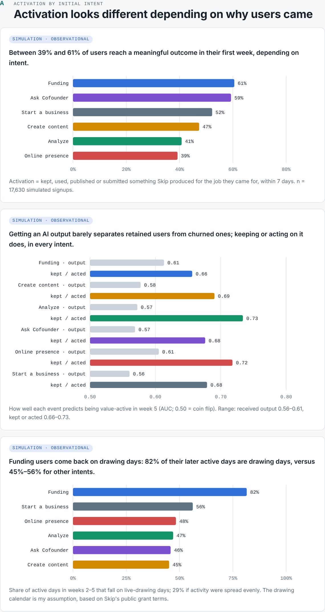
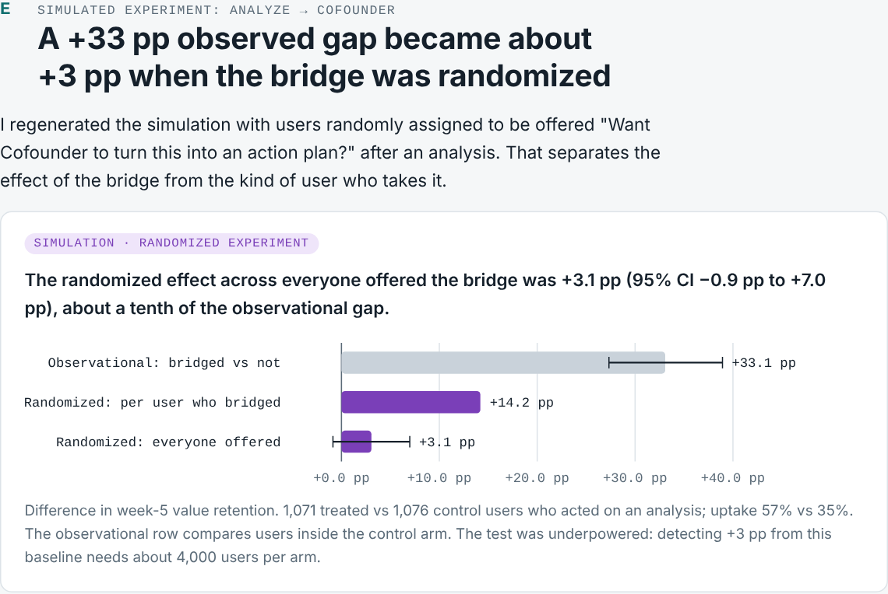
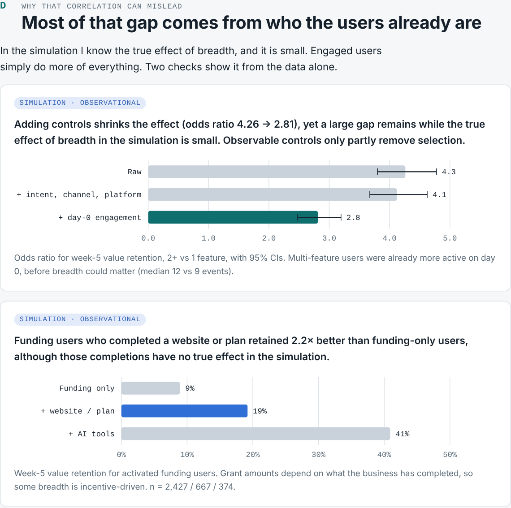
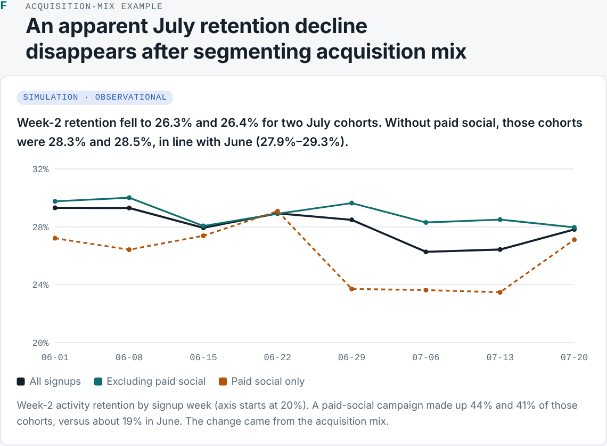

# Finding Skip's Activation Paths

**Caio Manoel Almeida Souza** · Product / Data / Analytics

**Does [Skip](https://helloskip.com) have one activation event, or does activation depend on why an entrepreneur came?**

> **Exploratory case study using synthetic data. Product observations are based on Skip's publicly available experience; no internal Skip data was used.** Every number in this repository comes from a simulation built to pressure-test the hypotheses; sources for product observations are in [docs/product-map.md](docs/product-map.md).

**Start here:** [EXECUTIVE_SUMMARY.md](EXECUTIVE_SUMMARY.md) (2-minute memo) · [dashboard/index.html](dashboard/index.html) (the argument in seven charts) · [CASE_STUDY.md](CASE_STUDY.md) (full case) · [analysis/FINDINGS.md](analysis/FINDINGS.md) (detailed results) · [docs/number-audit.md](docs/number-audit.md) (every quoted number, reproduced)

---

## The question

Skip lets an entrepreneur get funding, create marketing content, analyze a website, ask an AI Cofounder, build an online presence or write a business plan — all from one prompt bar.

> For each major user intent, what is the shortest path from "I came to Skip for something" to "Skip delivered enough value that I want to come back"?

## Motivation

A single activation metric for a multi-job product can average away opposite effects, count AI *generation* as value, and misread retention for users who return to scheduled grant drawings rather than to the tools. This project shows how I would find out whether that is happening, what evidence it would take, and which decisions the answer would drive.

## Screenshots

The dashboard reads top to bottom as one argument: A activation by intent → B outcome vs exploration → C cross-feature retention → D why that correlation misleads → E simulated Analyze → Cofounder experiment → F acquisition-mix example → G recommendations. Each chart leads with its takeaway and is labelled observational or experimental.

| A · Activation by intent | E · Simulated experiment |
|---|---|
|  |  |
| **D · Why the correlation misleads** | **F · Acquisition mix** |
|  |  |

Full page: [desktop](assets/screenshots/dashboard_desktop.png) · [phone](assets/screenshots/dashboard_phone.png)

Static figures used in the write-ups are in [assets/figures/](assets/figures/).

## Methodology

1. **Product research** — map surfaces, intents, entry points, first-value moments and monetization from public pages; keep observations and interpretation separate. → [docs/product-map.md](docs/product-map.md)
2. **Problem framing** — seven hypotheses, each with metric, denominator, required events, segments, confounders, support/reject criteria and product action. → [docs/problem-framing.md](docs/problem-framing.md)
3. **Activation taxonomy** — a proposed lifecycle (Acquisition → Intent → First Action → First Meaningful Outcome → Activation → Repeat Value → Retention → Monetization) with candidate events per intent. → [docs/activation-framework.md](docs/activation-framework.md)
4. **Instrumentation** — proposed event schema and data-quality validation. → [docs/event-tracking-plan.md](docs/event-tracking-plan.md)
5. **Synthetic data** — 17.6k users, 90 days, latent engagement, power users, bouncers, seasonality, a paid campaign, a tracking outage, duplicates, late events and QA accounts. Built so hypotheses can hold, fail, mislead or vanish under segmentation; ground truth kept outside `data/`. → [data/README.md](data/README.md)
6. **SQL** — Snowflake-dialect definitions and analyses, transpiled with sqlglot and validated against the data in DuckDB. → [sql/](sql/)
7. **Python** — bootstrap CIs, significance tests, effect sizes, logistic regression, selection checks, and a simulated randomized experiment. → [analysis/](analysis/)
8. **Experiments** — three designs with metrics, guardrails, randomization unit and sample size. → [docs/experiments.md](docs/experiments.md)

## Repository structure

```
.
├── EXECUTIVE_SUMMARY.md           2-minute memo
├── CASE_STUDY.md                  founder-first case study
├── APPLICATION_RESPONSE.md        answers to the two application questions
├── docs/
│   ├── product-map.md             public product research (with sources)
│   ├── problem-framing.md         hypotheses H1–H7
│   ├── activation-framework.md    proposed intent taxonomy & activation ladder
│   ├── event-tracking-plan.md     proposed schema & data-quality checks
│   ├── experiments.md             experiments A–C & decision framework
│   └── number-audit.md            how every quoted number is reproduced
├── data/                          SYNTHETIC users / events / subscriptions / drawing calendar
├── sql/
│   ├── 00_staging.sql             dedup, test accounts, clock skew, FMO events
│   ├── 01_user_activation.sql … 08_anomaly_detection.sql
├── analysis/
│   ├── product_analysis.py        statistics, figures, dashboard data
│   ├── simulated_experiment_b.py  randomized test inside the synthetic world
│   ├── sample_size.py             power calculations
│   ├── FINDINGS.md                results write-up
│   ├── results/                   results.json, simulated_experiment_b.json
│   └── sql_results/               every SQL query's output as CSV
├── dashboard/
│   ├── index.html                 single-page story dashboard (no build step)
│   └── data.js                    generated data
├── scripts/
│   ├── generate_synthetic_data.py
│   ├── run_sql.py                 Snowflake → DuckDB runner
│   ├── audit_numbers.py           checks every quoted number against outputs
│   ├── screenshot_dashboard.py
│   └── ground_truth.json          true synthetic effects (not read by the analysis)
└── assets/                        figures and screenshots
```

## How to run locally

```bash
python -m venv .venv && source .venv/bin/activate
pip install -r requirements.txt

python scripts/generate_synthetic_data.py      # ~20 s → data/*.csv (deterministic, seed 20261007)
python scripts/run_sql.py                      # runs sql/00–08, prints results, writes analysis/sql_results/
python analysis/simulated_experiment_b.py      # ~20 s → randomized world + results
python analysis/product_analysis.py            # stats, figures, dashboard/data.js
python scripts/audit_numbers.py                # verify every number quoted in the docs

open dashboard/index.html                      # or double-click; no server or build needed
```

Run a subset of SQL with `python scripts/run_sql.py 03 05`.

**Why no React/TypeScript build?** The dashboard is one HTML file with hand-drawn SVG charts and no dependencies, so it opens offline by double-click and the data stays in one generated file. For a one-page analytical story, a build toolchain would add setup cost without adding analytical value.

## Limitations

- **No access to Skip's data.** Every number is synthetic; product claims come from public pages only.
- **The synthetic world encodes my assumptions**, including which effects are real. It demonstrates that the method separates real effects from selection; it estimates nothing about Skip.
- **Intent is assumed inferable** from landing page and first action. If it isn't, that becomes the first piece of work.
- **The drawing schedule is invented**, as are all baselines in the experiment sample-size calculations.
- **Observational adjustment is imperfect.** Available engagement proxies are partly post-treatment, so causal questions end in experiments.

## What I would do with actual Skip data

1. Map Skip's existing events onto the proposed schema and list the gaps (especially server-side outcomes and output IDs).
2. Run the data-quality checks and ratio monitors in `sql/00` and `sql/08` before trusting any metric.
3. Compute per-intent activation ("kept or acted on an output") and value retention; compare with whatever activation metric Skip uses today.
4. Test the funding hypothesis directly: drawing-day concentration, activity vs value retention, funding → AI-tool continuation, and conversion.
5. Measure AI output acceptance by type and model version (H7) and pair it with thumbs-down reasons and support tickets.
6. Pick one experiment with Product (likely the Analyze → Cofounder bridge), size it from real baselines, and pre-register it.
