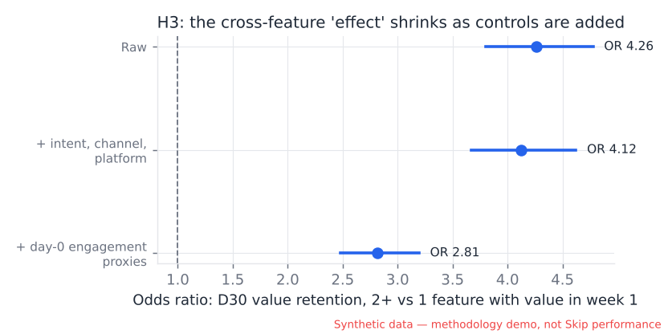
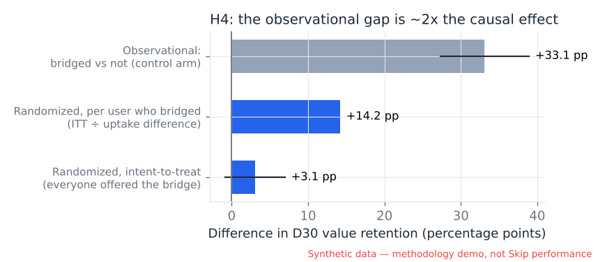
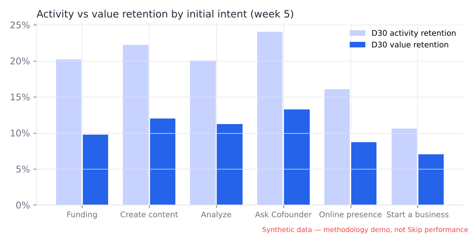
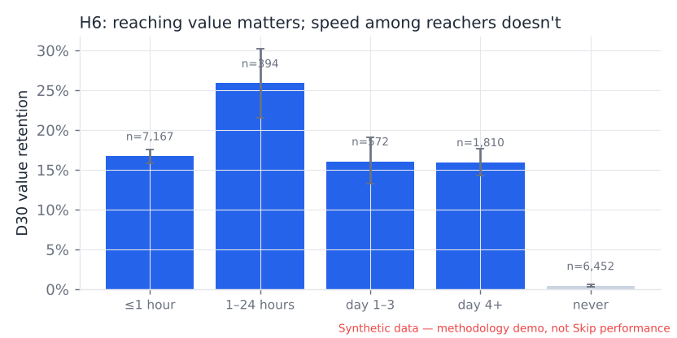

# Findings from the synthetic analysis

> **All behavioral data in this analysis is synthetic and is used solely to demonstrate the analytical methodology. It does not represent actual Skip users or performance.** Every number below describes the synthetic world, not Skip. What transfers to Skip is the *method* and the *traps it caught*.

Sources: `sql/*.sql` (definitions and descriptive cuts, validated in DuckDB) and `analysis/product_analysis.py` (bootstrap CIs with 2,000 resamples, two-proportion tests, Cohen's h, logistic regression). All numbers are in `analysis/results/results.json`.

---

## 0. Baseline (synthetic)

| Metric | Value | Denominator |
|---|---|---|
| Activation — intent-specific FMO ≤ 7d | **52.1%** (95% CI 51.4–52.9) | 17,630 signups |
| Activation — universal "any FMO ≤ 7d" | 57.7% | 17,630 |
| Median time to first value (users who reached it) | **6 minutes** | 10,709 |
| Never reached intent value in the window | 39.3% | 17,630 |
| D7 retention — activity / value | 27.9% / 14.8% | 17,630 |
| D30 retention — activity / value | 19.7% / 10.4% | 16,395 with D30 observed |
| Paid conversion ≤ 30d, net of refunds | 6.1% (gross 6.6%) | 17,630 |

**Reading:** the distribution of time-to-value is bimodal — most users who get value get it in the first session, and the rest mostly never do. A *median* TTFV of 6 minutes hides that 4 in 10 users never get there. The dashboard shows both.

---

## 1. Data quality first (sql/08)

Before any metric: 3,112 duplicate rows (0.5%), 32,795 events from 30 QA accounts (5.5%), 537 events timestamped before signup, 9,587 events arriving ≥24h late, 1,042 client events without a session.

**The iOS tracking break was caught by a ratio monitor.** iOS `analysis_completed / analysis_started` fell from ~98% to 0% on 14–16 July (z = −31.8). Two lessons:
- 17–18 July were **not** flagged, because the outage contaminated the trailing mean/SD. A production monitor should use a robust baseline (median/MAD) or exclude already-flagged days.
- 10 July is a likely **false positive** (z = −4.8 on 47 analyses). Monitors need minimum volumes and an alert budget.

Why it matters for activation: had Analyze activation been defined as "received an analysis", Analyze activation on iOS would have appeared to collapse for a week. Anchoring journeys on `analysis_started` and on server-side outcome events avoids this.

---

## 2. Hypothesis results

| | Hypothesis | Synthetic verdict | Key evidence |
|---|---|---|---|
| H1 | Activation is intent-dependent | **Mixed** | Universal and intent-specific FMOs predict D30 about equally well; but the universal metric counts users who got value elsewhere, and in 4 of 6 intents they retain at roughly half the rate |
| H2 | Completing an output > exploring | **Supported** | +13.6 pp D30 value retention (CI 12.7–14.6); holds in every intent; adjusted OR 3.6 |
| H3 | Cross-feature predicts retention | **Looks supported — mostly selection** | Adjusted OR 2.8, yet the true causal effect in this world is small |
| H4 | Analyze → Cofounder loop | **Real, but ~2× smaller than it looks** | Observational +33 pp vs. randomized +14 pp per bridged user; ITT +3.1 pp, not significant at n≈1,070/arm |
| H5 | Funding retains differently | **Supported** | 81.5% of funding users' week 2–5 active days are drawing days; conversion half of other intents |
| H6 | Speed beats breadth | **Not supported** | Reaching value matters (OR 25); speed among reachers does not (OR 0.87) |
| — | "July cohorts retain worse" | **Disappears after segmentation** | Paid-campaign mix shift; non-paid cohorts are flat |

### H1 — Is there one activation event?

For each intent, four candidates were compared on reach, raw lift in D30 value retention (bootstrap CI), adjusted odds ratio, and AUC (sql/02, `h1_candidates`):

| Intent | "Received an output" AUC | Universal FMO AUC | Intent FMO AUC |
|---|---|---|---|
| Funding | 0.61 | 0.65 | 0.66 |
| Create | 0.58 | 0.70 | 0.69 |
| Analyze | 0.57 | 0.73 | 0.73 |
| Ask | 0.57 | 0.69 | 0.68 |
| Presence | 0.61 | 0.73 | 0.72 |
| Start | 0.56 | 0.67 | 0.68 |

Two conclusions:
1. **"Got an AI output" is a weak activation event everywhere** (AUC 0.56–0.61). Keeping or acting on the output is what separates retained users. This is the most transferable finding for an AI product: *generation ≠ activation*.
2. **As a predictor, a universal FMO is as good as intent-specific ones.** That rejects the strong form of H1. But the universal metric **miscounts**: users activated only outside their intent retain at 8.7% vs 14.3% (Funding), 9.5% vs 22.7% (Analyze), 11.4% vs 17.7% (Presence), 5.7% vs 11.6% (Start); in Ask and Create the difference is within noise.

**So:** one *definition shape* ("kept or acted on an output") can be universal, but **activation must be reported per intent**, because what counts as an output, where users break, and how retention should be read (H5) all differ.

### H2 — Completion vs exploration

Users who opened ≥1 feature in week 1: those who completed an outcome retained at 16.8% vs 3.2% (D30 value; n = 9,123 vs 5,068; Cohen's h = 0.49). The gap is present in every intent and survives adjustment (OR 6.4 → 3.6 when adding day-0 engagement). In this world the true effect is large, so the conclusion is right — but the *size* still mixes cause and selection. Experiment C (first-value recovery) is the clean test.

### H3 — Cross-feature breadth: the trap

Activated users with value in 2+ features in week 1 retained at 31.3% vs 9.7%. Adding intent, channel and platform barely moved the odds ratio (4.26 → 4.12); adding day-0 engagement proxies moved it to 2.81. A typical analysis would stop here and recommend cross-selling.

The ground truth says otherwise: the true cross-feature effect is small (+0.12 on the daily-return logit, vs. +0.9 per SD of latent engagement). **Most of the observed gap is engaged users doing more of everything**, and the available proxies capture only part of that. Two further warnings visible in the data:
- Multi-feature users already had more day-0 events (median 12 vs 9) — breadth is partly a *symptom* of engagement.
- Among funding users, breadth is partly **incentive-driven** (website/plan completions), and those completions carry no causal value in this world.

### H4 — Analyze → Cofounder: a simulated experiment

Observationally, analyzers who reached Cofounder within 24h retained at 50.4% vs 21.0%; restricting to Analyze-intent users and adjusting still gave a large effect, and even among users who had all **acted** on their analysis the gap was 22.6 pp. Bridged users were visibly different *before* bridging (median 12 vs 8 events before their first analysis).

Because this world has a known ground truth, I ran the experiment proposed in docs/experiments.md (Experiment B) as a second, randomized simulation (`analysis/simulated_experiment_b.py`):

| Estimate | D30 value retention difference |
|---|---|
| Observational, bridged vs not (control arm) | **+33.1 pp** (CI 27.3–38.9) |
| Randomized, per user who actually bridged (ITT ÷ uptake gap 57%−35%) | **+14.2 pp** |
| Randomized, intent-to-treat | **+3.1 pp** (CI −0.9 to +7.0; p = 0.14) |

The loop has a real effect, but the observational number overstated it by more than 2×, and with ~1,070 users per arm the ITT is underpowered (detecting +3 pp from a 35% baseline needs ~4,000 per arm). This is the clearest illustration in the project of why "users who do X retain better" is a hypothesis, not a finding.

### H5 — Funding

- **Activity retention looks normal** (D30 activity 20.2%, middle of the pack) — a blended dashboard would not flag funding.
- **But it's drawing-driven:** 81.5% of funding users' active days in weeks 2–5 fall on drawing days (uniform would be 28.6%; other intents 45–56%). Funding has the lowest value-to-activity ratio of all six intents (0.49 vs 0.54–0.67).
- **Monetization differs:** 3.6% paid vs 7.4% for everyone else; adjusted OR 0.39 controlling for activation, channel and platform.
- **Funding + AI tools** users retained at 40.9% (value) vs 8.9% funding-only — but given H3, this is a hypothesis about a bridge, not proof of one.

### H6 — Speed vs breadth

| TTFV bucket | Users (D30 observed) | D30 value |
|---|---|---|
| ≤1 hour | 7,167 | 16.7% |
| 1–24 hours | 394 | 25.9% |
| Day 1–3 | 572 | 16.1% |
| Day 4+ | 1,810 | 16.0% |
| Never | 6,452 | 0.4% |

Reaching value is the dominant predictor (OR 25). Among users who reached value, same-day vs later makes no positive difference (OR 0.87, CI 0.76–0.99) — if anything, slower reachers retain slightly better, because reaching value on day 3 requires *coming back* on day 3, which is itself a sign of engagement. Feature count looks predictive (OR 2.2 per feature) but has the same selection problem as H3. **Neither speed nor breadth should be the steering metric; reach should.**

### Segmentation checks

- **The July retention "drop" disappears after segmentation.** D7 activity fell from ~29% to ~26% for the 6 and 13 July cohorts. Excluding paid social, those cohorts are at 28.3% and 28.5% — flat. The paid-social campaign changed the mix; nothing changed in the product.
- **Paid social looks worse after segmentation, not better.** Raw OR 0.79 vs other channels; adjusted for intent mix, 0.69. Its create-heavy mix (49% vs 14%) flatters it, because create retains relatively well. Segmentation doesn't only remove differences — sometimes it reveals them.

---

## 3. What I'd say to the founder (if these were real numbers)

1. Report activation per intent, defined as "kept or acted on an output", not "generated something".
2. Stop reading funding retention from activity; read it from value retention, and treat drawing returns as their own metric.
3. Don't fund a cross-sell program on the strength of "multi-feature users retain 3× better" — test it.
4. The Analyze → Cofounder bridge is worth an experiment, sized for a small effect.
5. Get more users to *any* value; don't obsess over shaving minutes off the first session.
